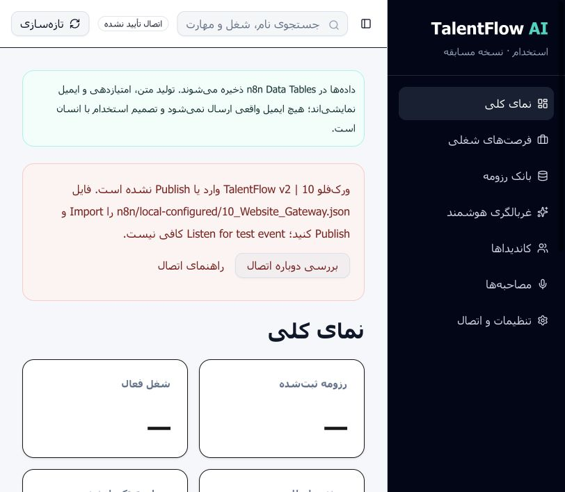
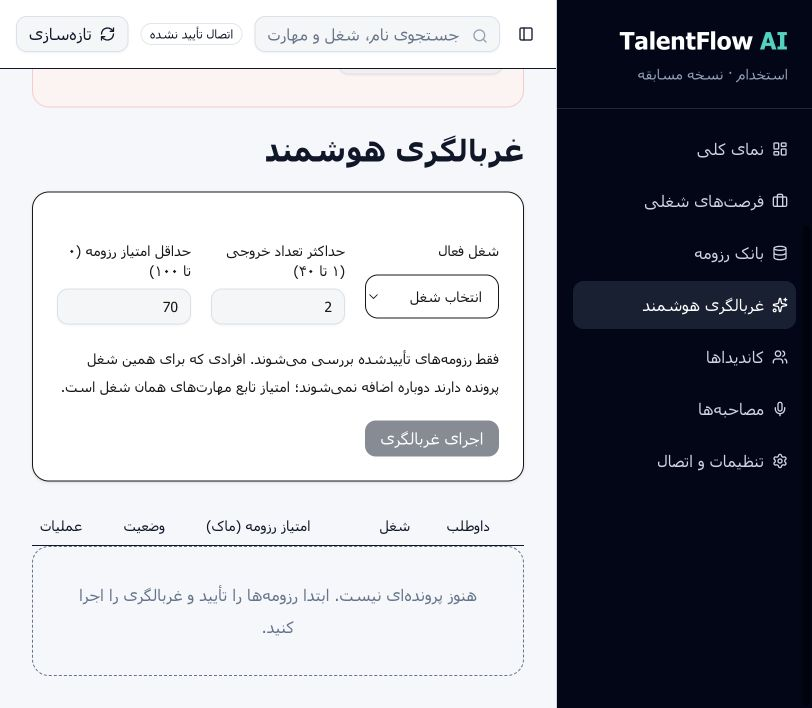

# TalentFlow — Recruitment Workflow Prototype

TalentFlow explores the handoff between a recruiter dashboard and a workflow backend: creating a role, reviewing candidates, collecting interview answers, and returning a report for a human decision. It has a Persian right-to-left interface and uses n8n workflow definitions for business operations and persistence.

This is a single-recruiter portfolio prototype, not a production hiring product. External AI and communication services are mocked. Local checks and pending cloud verification are documented separately.

## Interface preview

Real screenshots captured from the local application on 2026-09-25. These show the **disconnected, empty-state prototype**, not a completed recruitment demo. The n8n gateway was unavailable at capture time, so actions requiring it remain disabled. AI outputs and email delivery are mocked; no candidate records or credentials appear in these images.

### Dashboard



### Screening controls



پیش‌نمایش واقعی رابط کاربری در حالت قطع اتصال است؛ این تصاویر اجرای موفق فرایند استخدام یا ارزیابی واقعی داوطلب را نشان نمی‌دهند.

A full walkthrough video is pending successful n8n setup and end-to-end verification. See the [verification record](docs/VERIFICATION_V2.md) for the distinction between local tests and cloud execution.

## Project tour

The browser sends actions to a local TypeScript proxy. The proxy authenticates requests to n8n, where workflow nodes load records, run the business rules, persist changes, and return the result. The website gateway contains the complete action router; the numbered standalone workflows are alternate entry points, not subworkflows called by that gateway.

The business planner lives in `n8n/source/engine.mjs` and is embedded in generated n8n Code nodes. This keeps the domain rules testable outside n8n, although it means the solution is code-backed automation rather than a no-code implementation.

Records use a shared Data Table with a key, record kind, and JSON payload. This makes the prototype easy to import, but does not provide relational constraints, distributed locking, or multi-record transactions.

| Area | Implementation / boundary |
| --- | --- |
| Interface | React, TypeScript, Tailwind and shadcn components; Persian RTL |
| Local server | Vinext/Vite and a server-side n8n proxy |
| Workflows | n8n Webhook, Code and Data Table nodes |
| Persistence | Data Table workflow definitions; live cloud lifecycle still needs verification |
| AI and scoring | Deterministic mock outputs, not validated hiring assessments |
| Email and Drive | Simulated delivery and fictional sample resumes |
| Audio | Browser playback/recording; no server-side audio retention or real STT |

## Candidate review filters

The Persian **کاندیداها** view supports combined job and application-status filters, a visible/total count, and a reset control. Search matches candidate name, email, skills, and job title, department, location and skills. Every query term must occur somewhere in these fields; matching is literal and case-insensitive. Arabic yeh/kaf, common Arabic marks, spacing and Persian half-spaces are normalized for display search only. Source records, mock scores, ordering and human decisions are unchanged.

No-match feedback is distinct from an empty application list. Closed jobs remain searchable, and refreshing data does not silently clear an active filter. Filters apply to the loaded snapshot and reset on a full page reload; no n8n action is triggered by filtering. Job/resume search also uses the shared normalization.

Run `npm run test:search` for the isolated search tests (Node >=22.13). The CI workflow builds the application and runs the full test suite without connecting to n8n; this does not verify a live recruitment lifecycle.

## Documentation

- [Persian getting-started guide](START_HERE_FA.md)
- [Architecture and API boundaries](docs/ARCHITECTURE_V2.md)
- [Verification record](docs/VERIFICATION_V2.md)
- [Résumé wording](docs/RESUME.md)
- [Technical walkthrough in Persian](docs/TECHNICAL_WALKTHROUGH_FA.md)
- [GitHub preparation checklist](docs/GITHUB_PREPARATION_FA.md)
- [Roadmap](docs/ROADMAP.md)

## Python backend option

The dashboard can now connect to the standalone [TalentFlow Python](https://github.com/ghazalehgholinejad/talentflow-python) backend instead of n8n. Set `TALENTFLOW_BACKEND=python` and follow the [Persian setup guide](docs/PYTHON_BACKEND_FA.md). This uses an independent SQLite database; existing n8n records are not migrated. Without this setting, the original n8n path remains active.

## Run locally

Local Persian recruitment frontend, n8n Cloud business workflows, and n8n Data Table persistence. External AI, Drive and email outputs are explicitly mocked. No ChatGPT hosting, no paid API required.

Start with [the Persian step-by-step guide](docs/RUN_V2_FA.md). Architecture, endpoints, security boundaries and provider replacement notes are in [ARCHITECTURE_V2.md](docs/ARCHITECTURE_V2.md). Check [VERIFICATION_V2.md](docs/VERIFICATION_V2.md) for verified versus pending work; do not equate a passing build with an activated n8n account.

```bash
npm ci
npm run setup:n8n
# Import n8n/local-configured/00_Setup.json into your n8n project and execute it.
# Import n8n/local-configured/10_Website_Gateway.json into the SAME project and Publish.
npm run dev -- --port 5174 --strictPort
```

Open the Local URL printed by Vite. Keep that terminal open. Control+C stops it. `RUN_TALENTFLOW.command` is a macOS shortcut. Node >=22.13 required.

`00` + `10` run all website operations. `01`–`09` are independent alternate workflows provided for inspection, not mandatory dependencies of `10`. Use only the v2 release files. Existing older workflows are not migrated or overwritten.

## Checks

```bash
npm run workflows:build
npm run test:workflow
npx tsc --noEmit
npm run lint
npm test
```

The test suite runs Worker rendering in Miniflare, not plain Node's unsupported `cloudflare:` imports. It opens temporary loopback ports. Live smoke, which creates fictional records on your configured account:

```bash
node scripts/smoke-v2.mjs http://127.0.0.1:5174
```

## Scope

Implemented: draft/activate/close jobs, ingest fictional or typed resumes, human verification, job-specific shortlist, exclusion of previously considered pairs, HR approval/rejection with notes, distinct interview tokens, per-question persisted text answers, mock evaluation, recruiter report, final human decision and reload persistence.

Mock: job text, external Drive samples, question generation, scores, STT sample text, mail delivery. Audio recording is local playback only; no uploaded audio retention. Browser TTS depends on installed voices. Resume input supports text/TXT, not PDF/OCR. `N8N_MODE=live` is deliberately rejected until a real provider integration is implemented and tested.

Single-recruiter portfolio prototype, not a public production hiring system. No distributed transactions or multiuser authentication. Do not deploy/tunnel it or use sensitive real resumes. All n8n writes are authenticated. Secret-bearing `.env.local` and `n8n/local-configured/` are excluded from the shareable archive.

## Sharing the source

Run `node scripts/package-v2.mjs --portfolio` to create the allowlisted portfolio archive. It excludes local credentials and legacy project copies; inspect its contents before publishing. Use fictional records and remove private details from screenshots. Preserve third-party license notices. No project-wide open-source license has been selected yet.
